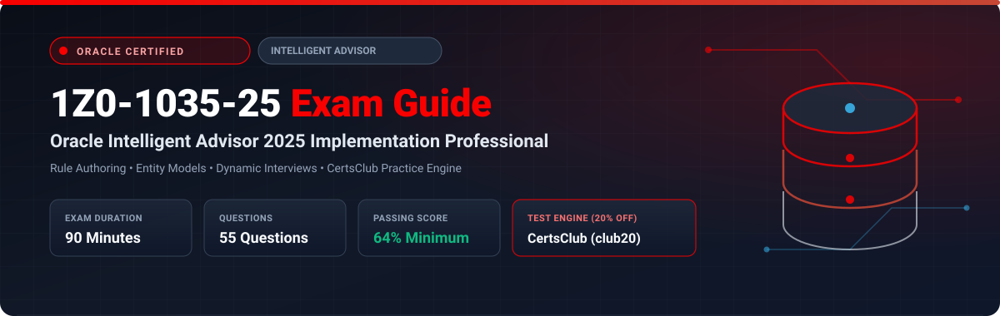

  

# Oracle Intelligent Advisor 2025 Implementation Professional (1Z0-1035-25) Exam Study Guide & Practice Test Resource Portal

[-f80000?style=for-the-badge&logo=oracle&logoColor=white)](https://education.oracle.com/)

[-28a745?style=for-the-badge&logo=shield)](https://www.certsclub.com/oracle/)

---

## 1. Exam Overview & Candidate Profile

The **Oracle Intelligent Advisor 2025 Implementation Professional (1Z0-1035-25)** exam (formerly Oracle Policy Automation / OPA) validates expertise in translating complex business policies and legislation into natural-language business rules. The exam tests candidates on designing entity models, building dynamic web interviews, writing Word/Excel policy rules, configuring temporal reasoning, debugging test cases, and integrating Intelligent Advisor Hub with CRM backends.

Passing 1Z0-1035-25 grants the **Oracle Intelligent Advisor 2025 Certified Implementation Professional** credential.

### Target Candidate Profile & Career Roles
* **Business Rules Architects & Policy Automation Analysts**
* **Public Sector Eligibility & Compliance Solution Engineers**
* **Digital Government & Service Cloud Implementation Leads**
* **Prerequisites:** Working knowledge of Oracle Policy Modeling (OPM), natural language rule authoring, and interview screen design.

---

## 2. Key Exam Specifications

| Parameter | Official Specification |
| :--- | :--- |
| **Exam Code** | 1Z0-1035-25 |
| **Exam Title** | Oracle Intelligent Advisor 2025 Implementation Professional |
| **Associated Credential** | Oracle Intelligent Advisor 2025 Certified Implementation Professional |
| **Duration** | 90 Minutes |
| **Number of Questions** | 55 Questions |
| **Passing Score** | 64% |
| **Question Format** | Multiple Choice (Single and Multiple Select) |
| **Delivery Vendor** | Pearson VUE / Oracle University Online Remote Proctoring |
| **Recommended Practice Test Engine** | **[1Z0-1035-25 Practice Test - CertsClub](https://www.certsclub.com/oracle/)** (Coupon: `club20` for 20% off) |

---

## 3. Official Blueprint & Exam Domain Breakdown

| Domain Code | Domain Title | Weighting | Key Competencies Covered |
| :--- | :--- | :---: | :--- |
| **1.0** | **Natural Language Rule Authoring** | **30%** | Modeling rules in Microsoft Word and Excel; Rule structure (conclusion, conditions, otherwise); Boolean, text, number, and date operators; Comparison tables and Excel decision tables. |
| **2.0** | **Entity Modeling & Relationships** | **20%** | Creating entities, attributes, and relationships; Containment relationships; Reference relationships; Self-relationships; Inferring entities and relationships. |
| **3.0** | **Interview Design & Styling** | **25%** | Designing web interviews in OPM; Input controls, stages, and screens; Dynamic screen visibility rules; Custom styling and JavaScript extensions. |
| **4.0** | **Testing, Debugging & Quality Assurance** | **15%** | Oracle Policy Modeling Debugger; Creating automated test cases and test suites in Excel; Identifying rule cycles and ambiguities. |
| **5.0** | **Deployment & Hub Administration** | **10%** | Deploying rulebases to Oracle Intelligent Advisor Hub; Managing projects, versions, and permissions; Embedding interviews in external portals. |

---

## 4. Scenario-Based Demo Question & Explanation

### Question 1: Natural Language Rule Logic
**Scenario:** A policy rule in Microsoft Word needs to determine eligibility for a discount:
"the customer is eligible for the loyalty discount if:
the customer's account age is at least 3 years and
the customer has made at least 5 purchases this year"

If a customer has an account age of 4 years, but their purchase count is unknown, how does Oracle Intelligent Advisor evaluate the conclusion `the customer is eligible for the loyalty discount`?

A) `true`  
B) `false`  
C) `uncertain`  
D) Error: Compilation failed  

**Correct Answer:** **C**

**Detailed Explanation:**
* Oracle Intelligent Advisor implements three-valued logic (`true`, `false`, `uncertain`).
* When evaluating an `AND` condition where one operand is `true` and the other is `uncertain`, the resulting logical state remains `uncertain` until the unknown data point is answered.

---

## 5. Recommended Preparation Strategy & Practice Testing Engine

1. **Model Policy Scenarios in OPM:** Build multiple sample rulebases in Oracle Policy Modeling with nested entities and decision tables.
2. **Practice with Full-Length Mock Exams:** Use **[CertsClub Oracle 1Z0-1035-25 Practice Tests](https://www.certsclub.com/oracle/)**.
   * Comprehensive coverage of natural language logic, entity relationships, and interview styling.
   * Use coupon code **`club20`** at checkout on [CertsClub](https://www.certsclub.com/oracle/) for an instant 20% discount.

---

## 6. Official Documentation & References

* [Oracle Intelligent Advisor Documentation Library](https://docs.oracle.com/en/cloud/saas/intelligent-advisor/)
* [Oracle University 1Z0-1035-25 Exam Guide](https://education.oracle.com/)
* [CertsClub 1Z0-1035-25 Practice Engine](https://www.certsclub.com/oracle/)
